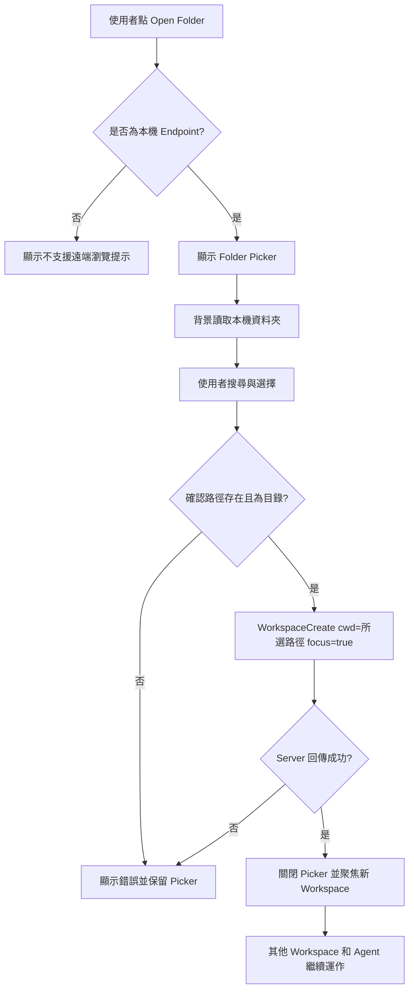

# Herdr 多專案資料夾管理：插件安裝指南與原生 TUI 功能設計

> 文件版本：1.0  
> 日期：2026-10-15（臺灣時間）  
> 主要平台：Windows 11 / PowerShell / Herdr  
> 原始碼檢視基準：[`herdrdev/herdr`](https://github.com/herdrdev/herdr) `master`，commit [`916fcf8de029c6cac965b50f3cdb9687cd7d1537`](https://github.com/herdrdev/herdr/commit/916fcf8de029c6cac965b50f3cdb9687cd7d1537)；`Cargo.toml` 版本為 `0.9.5`。  
> 插件檢視基準：[`Hon-Lu/herdr-new-workspace`](https://github.com/Hon-Lu/herdr-new-workspace) `main`，commit [`d8e563f9ba80d33c0a667a028198825f72895f60`](https://github.com/Hon-Lu/herdr-new-workspace/commit/d8e563f9ba80d33c0a667a028198825f72895f60)。  
> 文件性質：需求分析、原始碼確認、技術方案、操作指南與驗收計畫；**未修改任何 Herdr 原始碼，也未在使用者的 Windows 裝置上實際安裝、建置或執行測試。**

---

## 1. 需求背景與最終目標

### 1.1 現在遇到的問題

Herdr 是支援滑鼠與鍵盤的終端機多工管理器（TUI，Terminal User Interface），不是 WinForms 或 Electron 應用程式。它能同時管理多個 Workspace、Tab、Pane，以及位於其中的 Codex、Claude Code、OpenCode 等 Coding Agent。

使用者目前的痛點不是 Herdr 技術上只能開啟單一資料夾，而是：**缺少容易發現、容易使用的圖形化（終端機 UI）專案資料夾入口。** 既有建立 Workspace 流程通常沿用目前工作目錄，不容易直接選擇另一個專案；透過 CLI 指定路徑雖然可行，但指令長且不易記憶。

例如，希望在同一個 Herdr 視窗內同時保留以下三個互不干擾的工作環境：

```text
Herdr
└─ Workspaces
   ├─ AutoScan              C:/Projects/AutoScan
   │  ├─ Codex
   │  └─ Tests / Logs
   ├─ TicketPlus            C:/Projects/TicketPlus
   │  ├─ Codex
   │  └─ Code Review
   └─ AutoScrew             D:/Work/AutoScrew
      ├─ OpenCode
      └─ PowerShell
```

> 以上路徑只是示例，並非已確認存在於使用者電腦上的實際目錄。

### 1.2 必須達成的使用情境

1. 在 Herdr 畫面上開啟 **「Open Folder / 開啟專案資料夾」** 功能。
2. 能以鍵盤或滑鼠搜尋、瀏覽、選擇本機資料夾，不必背誦完整 CLI 指令。
3. 選中不同專案後，新增一個 Workspace，並讓新 Workspace 的終端機從所選路徑啟動。
4. 原有 Workspace 與正在執行的 Agent 保留，不因新增專案而關閉或更改工作目錄。
5. 之後可以直接點左側 Workspace 清單切換專案。
6. 最好有最近使用的專案紀錄，以及使用者可配置的專案根目錄。
7. 路徑不存在、無權限或讀取失敗時顯示錯誤；不得默默改用 Home 或其他資料夾。
8. Windows 路徑、Unicode／繁體中文資料夾名稱、滑鼠與鍵盤操作均應可用。

### 1.3 功能範圍

- **本次優先**：本機多資料夾 Workspace、Popup 選取器、搜尋、最近清單、焦點切換、錯誤回饋。
- **不包含**：移動既有 Agent 到另一個專案、把所有 Workspace 改成同一個 CWD、PLC/設備操作、自動執行任意腳本、默認替每個專案啟動 AI Agent。
- **遠端 SSH 機器**：Herdr 本身支援遠端機器，但「列出遠端檔案系統」是另一項需求；不得讓本機選取器誤以為本機路徑就是遠端路徑。

---

## 2. 結論：先用現成插件，不需要立即修改 Herdr 核心

已找到最貼近需求的現成第三方插件：

**[Hon-Lu/herdr-new-workspace](https://github.com/Hon-Lu/herdr-new-workspace)**（MIT License，含[繁體中文說明](https://github.com/Hon-Lu/herdr-new-workspace/blob/main/README.zh-TW.md)）。

檢查其 README、`herdr-plugin.toml`、`bin/new-workspace.mjs`、`bin/picker.mjs` 與 `bin/lib.mjs` 後，可確認其設計已包含：

| 需求 | 現成插件支援 | 說明 |
|---|---|---|
| 從 Herdr UI 開啟資料夾選擇器 | 是 | 使用 Herdr `placement = "popup"` 的插件 Pane。 |
| 在任意資料夾建立 Workspace | 是 | 選取後呼叫既有 `herdr workspace create --cwd <folder> --focus`。 |
| 模糊搜尋專案與資料夾 | 是 | 支援輸入片段、路徑補完、上下移動。 |
| 最近使用資料夾 | 是 | 插件自己的 `recent.json`。 |
| 自訂常用專案根目錄 | 是 | 插件 `config.json` 的 `roots`。 |
| Windows / Linux / macOS | 宣告支援 | Manifest 列出三平台；本文件未進行 Windows 實機驗證。 |
| 滑鼠操作 | 是 | 單擊選取、再次點擊開啟，支援滾輪。 |
| 在 Herdr 原生側欄增加獨立按鈕 | 否 | 目前是透過快捷鍵／插件 Action 打開 Popup；若要永久增加原生按鈕，需要修改核心。 |
| 選到已開啟的相同路徑時自動切換，而不新增重複 Workspace | 未實作 | 原始碼會直接呼叫 `workspace create`；不應宣稱它會自動重用舊 Workspace。 |

**建議選擇：** 先安裝並使用插件，直接滿足「在畫面選資料夾、無須打長命令」的核心需求。如果實際使用後仍希望左側顯示額外的 `+ Open Folder` 按鈕、固定專案清單或更深度整合，再考慮修改 Herdr 原始碼。

### 2.1 為什麼插件可以有 Popup，卻不等於原生 UI 元件？

Herdr Plugin v1 可宣告 `[[panes]]`，讓外部程式在 Overlay 或 Popup 終端機 Pane 中自行繪製互動介面。`herdr-new-workspace` 正是以 Node.js 程式在 Popup 內繪製選單。這不代表 Plugin v1 可以直接把新的 Ratatui Widget 或按鈕注入 Herdr 核心 Sidebar；官方[插件說明](https://github.com/herdrdev/herdr/blob/master/docs/next/website/src/content/docs/plugins.mdx)將「原生非終端機插件 UI」列為 v1 尚未支援的範圍。

因此 **Popup 插件方案** 與 **真正修改原生 Sidebar** 是不同層級，不應混為一談。

---

## 3. Windows 實際安裝教學（推薦方案）

以下操作只需設定一次。設定完成後，平常使用 **快捷鍵 + 選資料夾** 即可，不必再記指令。

### 3.1 確認 Herdr 與 Node.js

在 PowerShell 檢查：

```powershell
herdr --version
node --version
```

插件 README 的最低需求：

- Herdr `0.9.0` 或以上。
- Node.js `18` 或以上，且能直接透過 `node` 執行。
- 不需要額外的 npm 套件或手動 build。

如果尚未安裝 Herdr，可參考[官方安裝方式](https://github.com/herdrdev/herdr#install)或[Releases](https://github.com/herdrdev/herdr/releases)。官方 README 所列 Windows PowerShell 安裝方式為：

```powershell
powershell -ExecutionPolicy Bypass -c "irm https://herdr.dev/install.ps1 | iex"
```

> 上列為從網路下載並執行安裝腳本的指令，執行前應確認網址及腳本來源。若已安裝 Herdr，不需重複執行。

### 3.2 安裝 New Workspace 插件

```powershell
herdr plugin install Hon-Lu/herdr-new-workspace
```

安裝程式會顯示來源與將執行的命令，請檢查後再確認。安裝後可查詢：

```powershell
herdr plugin list
herdr plugin action list --plugin new-workspace
```

### 3.3 設定快捷鍵：Ctrl+B，接著 Ctrl+N

Herdr 的 Windows 設定檔（依插件 README）：

```text
%APPDATA%\herdr\config.toml
```

用 PowerShell 開啟：

```powershell
$config = Join-Path $env:APPDATA 'herdr\config.toml'
notepad $config
```

在 `config.toml` 最後加入：

```toml
[[keys.command]]
key = "prefix+ctrl+n"
type = "plugin_action"
command = "new-workspace.open"
description = "new workspace in a folder"
```

`prefix` 預設是 `Ctrl+B`。使用時：按下 **Ctrl+B**，放開後按 **Ctrl+N**。可依自己的按鍵設定修改，但應避開現有快捷鍵衝突。

重新載入 Herdr 設定：

```powershell
herdr server reload-config
```

### 3.4 設定常用專案根目錄

先查詢插件自己的設定資料夾：

```powershell
herdr plugin config-dir new-workspace
```

在該資料夾建立 `config.json`，內容例如：

```json
{
  "roots": [
    "C:/Projects",
    "D:/Work",
    "C:/Users/Public/Documents"
  ],
  "recent_limit": 12,
  "show_hidden": false
}
```

所有路徑都只是示例，應替換為電腦上真正存在的專案根目錄。Windows 下也可以在 JSON 內使用 `/`，避免反斜線跳脫問題。

| 設定 | 用途 | 預設值 |
|---|---|---|
| `roots` | 首頁常用根目錄；搜尋時也納入直接子資料夾 | `['~']` |
| `recent_limit` | 最近使用資料夾記錄筆數；`0` 關閉 | `8` |
| `show_hidden` | 是否顯示隱藏命名的資料夾 | `false` |

下次打開選擇器即會讀取更新的設定。最近使用紀錄會存於插件狀態資料夾的 `recent.json`；不是 Herdr 核心的專案清單。

### 3.5 日常操作

1. 在 Herdr 按 `Ctrl+B`，再按 `Ctrl+N`，出現 **New workspace** Popup。
2. 直接輸入 `AutoScan`、`TicketPlus` 等片段，或輸入 `C:\`、`D:\` 開始瀏覽路徑。
3. 用 `↑`、`↓` 移動，`Tab` 或 `→` 進入下一層，`←` 返回上層。
4. 按 `Enter` 在選取資料夾建立 Workspace；新 Workspace 立即取得焦點。
5. 要切換回原專案時，直接在左側 Workspace 清單點選，不需關閉任何工作環境。

| 按鍵 / 滑鼠 | 操作 |
|---|---|
| `Ctrl+B` → `Ctrl+N` | 開啟選擇器 |
| `↑` / `↓` | 選擇資料夾 |
| `Tab` / `→` | 補完路徑並進入子資料夾 |
| `←`、`Ctrl+W` | 返回上一層路徑 |
| `Enter` | 開啟所選資料夾為 Workspace |
| `Esc` | 先清空搜尋內容；輸入已空時關閉 Popup |
| 滑鼠滾輪 | 捲動清單 |
| 點一下、再點一次 | 選取、開啟該資料夾 |

如果要直接執行插件 Action，不依賴快捷鍵，也可使用：

```powershell
herdr plugin action invoke open --plugin new-workspace
```

這是**除錯與初次設定用途**，日常操作建議使用快捷鍵，不必記住。

### 3.6 常見問題與排除方式

| 現象 | 檢查與處理 |
|---|---|
| 按快捷鍵沒有反應 | 檢查 `config.toml`、`herdr server reload-config`、終端機快捷鍵是否衝突。 |
| 彈窗程式無法啟動 | 執行 `node --version`，確保 Node.js 在 `PATH`。 |
| 插件 Action 失敗 | 查詢 `herdr plugin log list --plugin new-workspace --limit 5`。 |
| 無法顯示預期專案 | 檢查 `roots` 目錄確實存在，或直接輸入完整磁碟路徑。 |
| 資料夾不存在或無讀取權限 | Popup 下方應顯示錯誤；改選可存取的路徑。 |
| 開啟相同資料夾產生多個 Workspace | 插件目前直接執行 `workspace create`，並未實作「先找既有 Workspace 再聚焦」。 |
| 更新插件 | 確認更新內容後使用 `herdr plugin update new-workspace`。 |
| 不再使用插件 | 使用 `herdr plugin uninstall new-workspace`；解除註冊不等於自動刪除所有使用者設定與歷史檔。 |

### 3.7 插件安全性

這是**第三方插件**，並非 Herdr 核心官方內建功能。Herdr 插件以目前使用者身分執行程式碼，並非受沙箱限制。安裝前應自行檢視 [`herdr-plugin.toml`](https://github.com/Hon-Lu/herdr-new-workspace/blob/main/herdr-plugin.toml) 及 `bin/` 程式。

本次檢視的版本採用 Node.js，主要工作是讀取目錄、在 Popup 顯示清單、透過 Herdr CLI 建立 Workspace、將最近路徑寫入自己的狀態目錄。本次**並未**進行獨立的完整安全稽核或實機測試，因此不能宣稱絕對安全。

---

## 4. Herdr Skill 與 Herdr Plugin 的差異

先前討論的這條指令：

```powershell
npx skills add herdrdev/herdr --skill herdr -g
```

安裝的是 **Herdr Agent Skill**，目的是教支援 Skill 的 Codex、Claude Code 等 AI Agent 如何操作 Herdr CLI；**不是新增資料夾選擇器的插件**。

| 類別 | 安裝指令 | 解決的問題 |
|---|---|---|
| Herdr 主程式 | Herdr 官方安裝程式 | 提供 TUI、Workspace、Tab、Pane、Agent 管理。 |
| Herdr Skill | `npx skills add herdrdev/herdr --skill herdr -g` | 讓 AI Agent 理解及操作 Herdr。 |
| New Workspace Plugin | `herdr plugin install Hon-Lu/herdr-new-workspace` | 從 UI Popup 選擇另一個專案資料夾，建立 Workspace。 |

**只想在 Herdr UI 加入專案資料夾，不需要先安裝 Skill。** 安裝 Herdr 主程式及上述第三方 Plugin 即可；Skill 為選用功能。

---

## 5. 原始碼架構確認：為什麼不需要先重寫底層？

### 5.1 使用技術

在 `Cargo.toml` 中已確認：

- 程式語言：Rust 2021 Edition。
- TUI / 畫面繪製：`ratatui = 0.30`。
- 終端機鍵盤與滑鼠：`crossterm = 0.29`。
- 指令列：`clap = 4.5`。
- 序列化：`serde`、`serde_json`、`toml`。
- 其他重要元件：`tokio`、`portable-pty`、`ghostty-vt`。

### 5.2 已經存在的 Workspace 建立 API

[`src/api/schema/workspaces.rs`](https://github.com/herdrdev/herdr/blob/916fcf8de029c6cac965b50f3cdb9687cd7d1537/src/api/schema/workspaces.rs) 已定義 `WorkspaceCreateParams`：

- `source_workspace_id: Option<String>`
- **`cwd: Option<String>`**
- `focus: bool`
- `label: Option<String>`
- `env: HashMap<String, String>`

[`src/app/api/workspaces.rs`](https://github.com/herdrdev/herdr/blob/916fcf8de029c6cac965b50f3cdb9687cd7d1537/src/app/api/workspaces.rs) 中的 `handle_workspace_create()` 已可接受明確傳入的 `cwd`，交給 `create_workspace_with_launch_env()` 建立 Workspace。沒有傳入 `cwd` 時，才按照目前的 Workspace 與 CWD 設定推導預設目錄。

**技術意涵：** 只要 UI 可取得所選資料夾的路徑，便能使用既有 Workspace API；本機基本功能無須新增 Socket Method 或重寫 PTY 啟動程序。

### 5.3 目前畫面上「新增 Workspace」為什麼仍不方便？

[`src/client/shell/actions.rs`](https://github.com/herdrdev/herdr/blob/916fcf8de029c6cac965b50f3cdb9687cd7d1537/src/client/shell/actions.rs) 的 `NewWorkspace` 動作：

- 當 `prompt_new_workspace_name = false` 時，直接傳送 `WorkspaceCreateParams { cwd: None, ... }`，沿用 Workspace 的預設路徑規則。
- 當 `prompt_new_workspace_name = true` 時，執行 `open_new_workspace_overlay()`。

[`src/client/shell/overlay_input.rs`](https://github.com/herdrdev/herdr/blob/916fcf8de029c6cac965b50f3cdb9687cd7d1537/src/client/shell/overlay_input.rs) 的 `open_new_workspace_overlay()` 開啟的是**輸入 Workspace 名稱**的通用 Rename Overlay。它的 `cwd` 是從目前 Workspace Snapshot 推導，並非提供任意資料夾的瀏覽選取功能。

因此，單純開啟 `prompt_new_workspace_name` **不能解決**「在畫面中挑選其他專案資料夾」的需求。

### 5.4 既有可重用 UI 程式碼

| 現有檔案 | 功能 | 新增功能時建議做法 |
|---|---|---|
| [`src/client/shell/state.rs`](https://github.com/herdrdev/herdr/blob/master/src/client/shell/state.rs) | `ClientShellOverlay`、UI 狀態、命中測試資料 | 若修改核心，新增 `ProjectFolderPicker` Overlay 狀態。 |
| [`src/client/shell/overlays.rs`](https://github.com/herdrdev/herdr/blob/master/src/client/shell/overlays.rs) | Popup 與 Overlay 渲染入口 | 沿用 `popup()`、`panel()`、按鈕與 OverlayRender。 |
| [`src/client/shell/worktree_overlays.rs`](https://github.com/herdrdev/herdr/blob/master/src/client/shell/worktree_overlays.rs) | 既有 Worktree 建立／開啟清單 Popup | 參考清單、搜尋、選取、錯誤顯示的 UI 寫法。 |
| [`src/client/shell/text_editor.rs`](https://github.com/herdrdev/herdr/blob/master/src/client/shell/text_editor.rs) | 支援游標編輯及 Unicode 的文字欄位 | 重用資料夾路徑輸入框。 |
| [`src/client/shell/overlay_input.rs`](https://github.com/herdrdev/herdr/blob/master/src/client/shell/overlay_input.rs) | Overlay 鍵盤輸入及儲存操作 | 增加目錄導航、選取、確認與取消事件。 |
| [`src/client/shell/mouse.rs`](https://github.com/herdrdev/herdr/blob/master/src/client/shell/mouse.rs) | 滑鼠命中測試、Sidebar 與 Popup 操作 | 增加 Folder 按鈕與清單滑鼠事件。 |
| [`src/client/shell/sidebar.rs`](https://github.com/herdrdev/herdr/blob/master/src/client/shell/sidebar.rs) | 工作區側欄繪製 | 在空間允許時顯示 `+ Open Folder`。 |
| [`src/client/shell/global_menu.rs`](https://github.com/herdrdev/herdr/blob/master/src/client/shell/global_menu.rs) | 全域選單 | 新增容易找到的 `Open Folder...` 入口。 |
| [`src/client/shell/actions.rs`](https://github.com/herdrdev/herdr/blob/master/src/client/shell/actions.rs) | UI Action → Endpoint API Request | 將選中的 `cwd` 傳給既有 `WorkspaceCreate`。 |
| [`src/app/creation.rs`](https://github.com/herdrdev/herdr/blob/master/src/app/creation.rs) | 新 Workspace 與 Pane 建立 | 大部分邏輯可沿用，必要時加強錯誤驗證。 |
| [`src/client/shell/tests/workspace_navigation.rs`](https://github.com/herdrdev/herdr/blob/master/src/client/shell/tests/workspace_navigation.rs) | Workspace 導覽測試 | 補充新功能的鍵盤／滑鼠與焦點回歸測試。 |

> Git Worktree 的 `Open worktree...` 是「開啟現有 Git worktree」而非「瀏覽任意專案資料夾」。可重用 UI 樣式，但不應把一般資料夾強制當作 Git worktree。

---

## 6. 若要修改 Herdr 原生 UI：詳細功能規格

以下屬於**下一階段可選的核心功能設計**，不是宣稱目前已實作的功能。若現成插件已滿足日常工作，應避免額外修改主程式。

### 6.1 設計原則

1. **沿用既有 Workspace 模型**：每個新專案對應新建 Workspace，保留原 Workspace 與 Pane。
2. **保留原有快捷鍵與按鈕語意**：`New Workspace` 維持既有行為；額外提供 `Open Folder...`，不要直接破壞原本流程。
3. **先做本機**：本機檔案系統可由本機 UI 瀏覽。SSH Remote 尚未有對等目錄列舉 API，不能偷用本機目錄。
4. **無額外套件優先**：使用目前已安裝的 `ratatui`、`crossterm`、`TextEditor`，搭配 Rust 標準檔案系統 API 即可；不引入 WinForms、Electron 或不必要的 UI Framework。
5. **絕不改動其他 Workspace 的 CWD**：新增 Workspace 是獨立操作。
6. **畫面渲染與目錄 I/O 分離**：大型磁碟、UNC 網路分享、權限問題不得卡住 UI 主迴圈。
7. **錯誤可觀察**：選擇失敗時留在 Popup，錯誤可見，不能悄悄改到其他目錄。

### 6.2 建議的 UI 入口

- 左側 `Workspaces` 清單增加 **`+ Open Folder`**；原有 `+ New Workspace` 保留。
- 全域選單新增 **`Open Folder...`**，以便收合側欄或視窗很窄時仍可操作。
- 快捷鍵可另設一個使用者可配置的 Action（非 MVP 必要條件）。

### 6.3 Popup 草圖（純文字示意）

```text
┌─────────────────────────────────────────────────────────────────────┐
│  Open Project Folder                                                │
│                                                                     │
│  Search or path: C:\Projects\au_                                    │
│  ─────────────────────────────────────────────────────────────────  │
│  > AutoScan                   C:\Projects\AutoScan                    │
│    AutoScrew                  C:\Projects\AutoScrew                   │
│    AutomationTools            C:\Projects\AutomationTools             │
│                                                                     │
│  Recent                                                             │
│    TicketPlus                 D:\Work\TicketPlus                      │
│                                                                     │
│  [Enter Open]   [Tab Browse]   [Esc Cancel]                          │
└─────────────────────────────────────────────────────────────────────┘
```

**Popup 行為：**

- 支援輸入完整路徑、磁碟代號、名稱片段及模糊搜尋。
- 選取目錄後顯示完整路徑；不能只顯示名稱，因不同根目錄可能有同名專案。
- `Enter` 以選中路徑呼叫 WorkspaceCreate，成功後聚焦新 Workspace。
- `Esc` 取消，不建立任何 Workspace。
- `Tab` 進入下一層；向上返回上層目錄；滑鼠滾輪與點擊可用。
- 找不到任何符合目錄時提供空狀態提示，不自動建立不存在的路徑。
- 若資料夾可讀但不是 Git Repo，一樣可以開啟。
- 開啟同一路徑時可先允許多個 Workspace；若未來要避免重複，必須使用可靠的 Workspace 根路徑識別，不可只比較顯示名稱或「目前 Pane 的動態 CWD」。

### 6.4 原生 UI 資料結構建議

**UI 狀態（只放 ClientShell）：**

```text
ProjectFolderPickerState
    input: TextEditor
    current_directory: PathBuf
    entries: Vec<DirectoryEntryView>
    selected_index: usize
    scroll_offset: usize
    loading: bool
    error: Option<String>
    request_generation: u64

DirectoryEntryView
    display_name: String
    absolute_path: PathBuf
    kind: Directory
```

以上是**設計用欄位示例**，不是現有 Herdr Rust 型別，也不是已通過編譯的程式碼。目錄資料及錯誤應留在 Client UI；Workspace 真正建立後的身分及 Pane Process 狀態仍由 Server/API 管理。

**MVP 持久化：** 只要 Session 可恢復目前 Workspace，且不需要未開啟專案的收藏清單，就不必增加核心資料模型。若要求「關閉 Workspace 後仍可從 Recent 重新開啟」，再新增獨立 Recent Project 路徑設定或採現成插件既有 `recent.json` 管理，不要直接把「目前有開的 Workspace」誤當成「所有收藏的專案」。

### 6.5 事件及執行流程



### 6.6 偽代碼

```text
ON OpenFolderClicked:
    IF active_endpoint is not Local:
        show_error("目前只支援本機資料夾瀏覽")
        RETURN

    picker = new ProjectFolderPickerState(start_directory = last_used_or_home)
    open_overlay(picker)
    request_directory_listing_async(picker.current_directory, picker.request_generation)

ON DirectoryListingCompleted(result, generation, directory):
    IF picker_no_longer_open OR generation != picker.request_generation:
        RETURN
    IF directory != picker.current_directory:
        RETURN
    picker.loading = false
    IF result.failed:
        picker.error = result.message
        RETURN
    picker.entries = filter_and_sort_directories(result.directories, picker.input)

ON UserConfirmFolder(selected_path):
    IF selected_path is empty:
        show_error("請選擇資料夾")
        RETURN
    IF NOT is_existing_readable_directory(selected_path):
        show_error("目錄不存在或無法存取")
        RETURN

    request WorkspaceCreate(
        source_workspace_id = None,
        cwd = selected_path.absolute_path_as_text,
        focus = true,
        label = None,
        env = empty
    )

ON WorkspaceCreateResponse(response):
    IF response.success:
        close_folder_picker()
        reveal_new_workspace_in_sidebar()
    ELSE:
        keep_picker_open_and_show_error(response.error)
```

**非同步注意事項：** 不能在每個鍵盤事件同步掃描大量目錄，否則網路路徑、損壞磁碟或大量子資料夾可能卡住終端機。背景結果需要以 `request_generation` 或等效機制拒收過期清單。

### 6.7 Windows 路徑／安全細節

- 支援 `C:\Projects\...`、`D:/Work/...`、含空格或中文的目錄與 UNC 路徑（如 `\\server\share\repo`），但遠端網路分享需實測延遲與權限。
- API 傳入路徑值本身，**不要組成 Shell Command 字串再執行**；可沿用 Herdr 已有的結構化 WorkspaceCreate Method。
- 若使用 `std::fs::canonicalize()` 進行去重，注意 Windows `\\?\` 延伸路徑格式可能影響外部工具相容性。Herdr 過往已有[相關議題 #5161](https://github.com/herdrdev/herdr/issues/5161)；顯示用路徑、系統操作路徑及比較用識別需分別處理。
- 防止將不存在／失效路徑默默轉為 Home 目錄；驗證應涵蓋「選取後、建立前」被其他程序刪除的競態。
- 不能任意修改、刪除、搬移選中資料夾；「Open Folder」只做唯讀瀏覽及建立 Workspace。
- `Windows Terminal`、PowerShell、CMD、不同字元寬度及 IME 的操作應列入測試。
- 同名資料夾可用完整路徑辨識；不可依 `AutoScan` 這種顯示名稱判斷是否為相同資料夾。

### 6.8 建議改動檔案（核心方案）

以下是**實作計畫**，尚未執行：

| 預計檔案 | 預計修改 |
|---|---|
| `src/client/shell/state.rs` | 新增 `ProjectFolderPicker` Overlay 與 UI 互動狀態。 |
| `src/client/shell/overlays.rs` | 連接新的 Popup 渲染分支。 |
| `src/client/shell/folder_picker.rs`（新增） | 管理路徑與資料夾清單、篩選、選取、非同步讀取狀態。 |
| `src/client/shell/folder_picker_overlay.rs`（新增） | 繪製選取器、錯誤、空狀態、按鈕。 |
| `src/client/shell/overlay_input.rs` | 新增選取器鍵盤事件與 `WorkspaceCreate` 提交。 |
| `src/client/shell/mouse.rs` | 支援清單點擊與捲動。 |
| `src/client/shell/global_menu.rs` | 增加 `Open Folder...` 可見入口。 |
| `src/client/shell/sidebar.rs` | 在側欄寬度足夠時新增操作入口。 |
| `src/client/shell/actions.rs` | 呼叫既有 WorkspaceCreate（附明確 `cwd`）。 |
| `src/client/shell/mod.rs` | 將新增的檔案納入 Module Tree。 |
| `src/client/shell/tests/...` | 新增 UI 行為與回歸測試。 |

**預期不需要變更** `WorkspaceCreateParams` 的 API 欄位或重構 `AppState`。如測試發現既有 API 對不存在目錄會錯誤回落到其他目錄，再針對該缺陷增加驗證與回歸測試；不要在未確認前擴大改動。

---

## 7. 分階段實施規劃

| 階段 | 內容 | 是否需要修改 Herdr 主程式 | 交付驗收 |
|---|---|---|---|
| A：立即可用 | 安裝 `Hon-Lu/herdr-new-workspace`，設定快捷鍵與 `roots` | 否 | Popup 能選擇 AutoScan / TicketPlus 等不同目錄，建立多個 Workspace。 |
| B：使用體驗優化 | 依實際需求調整快捷鍵、Recent、根目錄；必要時 fork 插件改進 | 否 | 常用專案只需少量按鍵便能選到。 |
| C：真正原生 UI | 修改 Herdr Rust TUI，增加側欄入口與原生 Folder Picker | 是 | 功能無需第三方 Node 插件，與 Herdr 原生 Overlay、主題、滑鼠操作一致。 |
| D：進階擴充 | 收藏／釘選專案、遠端目錄瀏覽、開啟已存在 Workspace 自動聚焦 | 可能 | 依新功能另設規格；不作為本次最低完成條件。 |

**不要直接從 D 階段開始。** 使用者目前的核心痛點可先由 A 階段解決。

---

## 8. 測試計畫與驗收標準

### 8.1 插件方案（實機手動驗收）

- [ ] `herdr --version` 顯示符合插件的最低要求。
- [ ] `node --version` 為 `v18` 或更新版本。
- [ ] `herdr plugin list` 可看到 `new-workspace`。
- [ ] 按 `Ctrl+B` → `Ctrl+N` 可以顯示資料夾 Popup。
- [ ] 能從 `C:` 根目錄或已設定的 `roots` 瀏覽到第一個專案。
- [ ] 能以模糊搜尋找到第二個專案。
- [ ] 開啟新專案時原先的 Workspace 不會關閉。
- [ ] 新 Workspace 的終端機實際位於所選專案資料夾，而非原專案或 Home。
- [ ] 至少兩個不同專案可以同時存在並切換。
- [ ] 關閉 Popup 後可再次開啟，最近使用的路徑仍在清單中。
- [ ] 路徑不存在與無權限情境有清楚錯誤提示。
- [ ] 含空格、繁體中文名稱的 Windows 資料夾可開啟。
- [ ] `Esc` 取消不新增 Workspace。
- [ ] 窗口縮放或長清單滾動後，按鍵與滑鼠仍能正確選取。

### 8.2 核心修改方案（若進入 C 階段）

**程式測試：**

1. Picker Overlay 開關與 Keyboard / Mouse 命中測試。
2. 輸入文字、搜尋、上一層、下一層、空清單及取消測試。
3. 目錄搜尋結果過期回傳時不覆蓋目前狀態。
4. `WorkspaceCreate.cwd` 精確等於使用者選取的完整路徑。
5. Server 建立失敗時 Popup 保留原有選取與錯誤訊息。
6. 既有 `NewWorkspace`、Rename、Tab、Worktree 互動不受影響。
7. Client Shell 不會在處理 I/O 時阻塞既有 Agent 顯示與輸入。
8. 新建後 Workspace 可獨立切換；原 Workspace 與 Pane 不被關閉。
9. Windows 路徑（大小寫、Unicode、UNC、檔案已刪除）、Unix 路徑均有測試。
10. SSH 遠端 Endpoint 沒有遠端瀏覽能力時，必須禁止誤用本機路徑並明確告知。

**Herdr 專案的常用驗證指令（僅列計畫，尚未執行）：**

```bash
just test
just check
```

README 也列出 `cargo build --release` 作為建置方式。完整 `just check` 在不同平台可能包含平台專屬檢查及額外 SDK 需求，應遵守專案的 `AGENTS.md`、`CONTRIBUTING.md` 和 `justfile`。

### 8.3 定義「完成」

對本次需求，**插件方案完成**的意義是：使用者不再需要輸入長 CLI 指令，能在 Herdr 畫面中自行選擇任意存在的本機專案目錄，為不同專案建立 Workspace 並切換，而且原工作環境不受影響。

**原生方案完成**需要此外確認：新增的原生 UI 操作入口、所有目錄選擇互動、錯誤處理、自動化測試、Windows 實機測試及回歸檢查均通過。

---

## 9. GitHub 上游開發與授權注意事項

Herdr 的 [`CONTRIBUTING.md`](https://github.com/herdrdev/herdr/blob/master/CONTRIBUTING.md) 明確說明：**不接受一般外部貢獻者自行提交未受邀請的實作 PR**，功能建議應優先使用 GitHub Discussions。這不影響根據 Apache-2.0 授權在自己的 Fork 中研究與修改，但不要把「完成 Fork」等同於上游會接受 PR。

建議開發策略：

1. 先測試現成插件，確認實際是否仍有不足。
2. 若只想改善 Popup 的使用體驗，可以 Fork `Hon-Lu/herdr-new-workspace`，修改其 JavaScript 程式並透過 `herdr plugin link <local-path>` 測試。
3. 若一定要增加 Herdr 核心側欄按鈕或 Rust 原生 Picker，再 Fork `herdrdev/herdr` 做核心修改。
4. 如希望功能進入官方版本，先在 Discussions 簡短說明實際問題與使用情境，依維護者政策處理；不要未經批准直接建立實作 PR。

---

## 10. 其他可參考的現成插件

| 插件 | 特性 | Windows 情況 | 適用情境 |
|---|---|---|---|
| [`Hon-Lu/herdr-new-workspace`](https://github.com/Hon-Lu/herdr-new-workspace) | Popup 瀏覽任意資料夾、模糊搜尋、Recent、常用 Root | 宣告支援 Windows、Linux、macOS | **本需求首選** |
| [`alon-z/herdr-command-palette`](https://github.com/alon-z/herdr-command-palette) | 搜尋已開 Workspace 與配置的專案資料夾；若已開啟則聚焦 | Manifest 宣告 Windows 支援 | 偏好命令面板＋避免重複開啟相同專案 |
| [`ismaelosuna7824/herdr-recent-workspaces`](https://github.com/ismaelosuna7824/herdr-recent-workspaces) | 最近資料夾歷史與 Browser；選取已開 Workspace 時聚焦 | Manifest **僅**列 Linux、macOS | Windows 不是首選 |
| [`mike-bronner/herdr-plugin-project-finder`](https://github.com/mike-bronner/herdr-plugin-project-finder) | 多選 Git Repo、一次開啟／關閉 Workspace | README／Manifest 明示 Windows 尚未實機驗證，且 Popup 啟動使用 `sh` | 不建議作為 Windows 首選 |

上表基於各專案 README 與 Manifest，非逐一實機測試結果。這些第三方插件可以協助取捨，但不代表都與使用者目前安裝的 Herdr 版本完全相容。

---

## 11. 可交給 Coding Agent 的實作任務摘要（僅在需要原生核心功能時使用）

> 任務：為 Herdr Rust TUI 增加 `Open Folder...` 功能，讓使用者可在操作畫面中選擇本機資料夾並建立獨立 Workspace。先閱讀 `AGENTS.md`、`CONTRIBUTING.md`，核對目前源碼與依賴。優先沿用 `ClientShellOverlay`、`TextEditor`、`worktree_overlays` 的 UI 樣式及既有 `WorkspaceCreateParams.cwd`，不要新增不必要的 API、GUI Framework 或相容層。保持原有 `NewWorkspace` 行為不變。新增原生側欄或全域選單入口、可鍵鼠操作的本機資料夾 Popup、非阻塞目錄讀取、嚴格路徑驗證、成功／失敗回饋。建立新 Workspace 後焦點移至新環境，原有 Workspace 與 Agent 不得受影響。先以本機為範圍，遠端 Endpoint 不得錯用本機路徑。為 UI 輸入、WorkspaceCreate 路徑傳遞、錯誤及回歸行為補齊測試；執行 `just test` 和 `just check`，並進行 Windows 實機操作驗收。不得宣稱通過尚未執行的檢查；不得未經上游批准發送 PR。

---

## 12. 參考資料（優先以固定 commit 版本追溯）

**Herdr 核心：**

- [Herdr GitHub Repository](https://github.com/herdrdev/herdr)
- [Herdr README](https://github.com/herdrdev/herdr/blob/916fcf8de029c6cac965b50f3cdb9687cd7d1537/README.md)
- [Cargo.toml：實際語言與依賴](https://github.com/herdrdev/herdr/blob/916fcf8de029c6cac965b50f3cdb9687cd7d1537/Cargo.toml)
- [src/api/schema/workspaces.rs：WorkspaceCreateParams](https://github.com/herdrdev/herdr/blob/916fcf8de029c6cac965b50f3cdb9687cd7d1537/src/api/schema/workspaces.rs)
- [src/app/api/workspaces.rs：handle_workspace_create](https://github.com/herdrdev/herdr/blob/916fcf8de029c6cac965b50f3cdb9687cd7d1537/src/app/api/workspaces.rs)
- [src/client/shell/actions.rs：NewWorkspace 行為](https://github.com/herdrdev/herdr/blob/916fcf8de029c6cac965b50f3cdb9687cd7d1537/src/client/shell/actions.rs)
- [src/client/shell/overlay_input.rs：Workspace Overlay](https://github.com/herdrdev/herdr/blob/916fcf8de029c6cac965b50f3cdb9687cd7d1537/src/client/shell/overlay_input.rs)
- [Herdr Plugin 官方文件](https://github.com/herdrdev/herdr/blob/916fcf8de029c6cac965b50f3cdb9687cd7d1537/docs/next/website/src/content/docs/plugins.mdx)
- [Herdr Keyboard 官方文件](https://github.com/herdrdev/herdr/blob/916fcf8de029c6cac965b50f3cdb9687cd7d1537/docs/next/website/src/content/docs/keyboard.mdx)
- [AGENTS.md](https://github.com/herdrdev/herdr/blob/916fcf8de029c6cac965b50f3cdb9687cd7d1537/AGENTS.md)
- [CONTRIBUTING.md](https://github.com/herdrdev/herdr/blob/916fcf8de029c6cac965b50f3cdb9687cd7d1537/CONTRIBUTING.md)

**現成插件：**

- [Herdr New Workspace — 繁體中文 README](https://github.com/Hon-Lu/herdr-new-workspace/blob/d8e563f9ba80d33c0a667a028198825f72895f60/README.zh-TW.md)
- [Herdr New Workspace — Plugin Manifest](https://github.com/Hon-Lu/herdr-new-workspace/blob/d8e563f9ba80d33c0a667a028198825f72895f60/herdr-plugin.toml)
- [Herdr New Workspace — Picker 原始碼](https://github.com/Hon-Lu/herdr-new-workspace/blob/d8e563f9ba80d33c0a667a028198825f72895f60/bin/picker.mjs)
- [Herdr New Workspace — 共用操作與 Recent 原始碼](https://github.com/Hon-Lu/herdr-new-workspace/blob/d8e563f9ba80d33c0a667a028198825f72895f60/bin/lib.mjs)
- [Herdr Command Palette](https://github.com/alon-z/herdr-command-palette)
- [Herdr Recent Workspaces](https://github.com/ismaelosuna7824/herdr-recent-workspaces)
- [Herdr Project Finder](https://github.com/mike-bronner/herdr-plugin-project-finder)

---

## 最終建議

**先安裝 `Hon-Lu/herdr-new-workspace`，設定一組 `Ctrl+B` → `Ctrl+N` 快捷鍵與常用專案根目錄。** 這已經是能讓使用者在 Herdr 操作畫面中加入其他專案資料夾的完整、低成本方案。原生 Rust UI 修改應只在使用後確認插件 Popup 不足，且真的需要固定側欄按鈕或更深度整合時進行。
